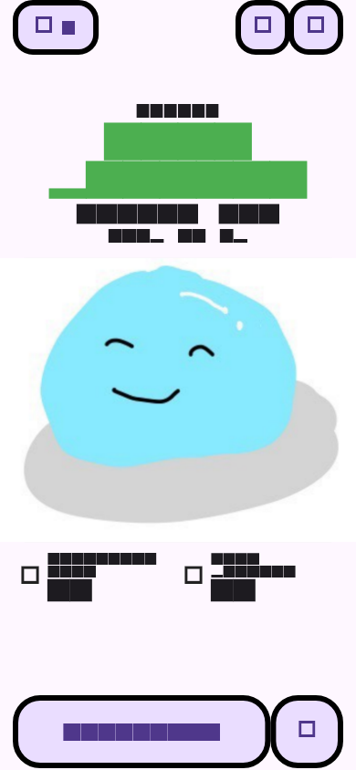

# Posture Guard

**A Flutter app that helps users notice when they're holding their phone too low.**

Posture Guard uses phone motion sensors to estimate device angle and remind users to adjust their position. The Android prototype supports background monitoring, with optional front-camera assistance while the app is open.

---

## What it does

- **Monitors phone angle.** You calibrate a comfortable position, then the app uses motion-sensor readings to identify when the phone is tilted too low.
- **Sends posture reminders.** Android monitoring runs through a foreground service, so it can continue while you're using other apps. Notifications and reminder timing are configurable.
- **Offers optional camera assistance.** When the app is visible, on-device face detection can provide another signal. Sensor-only monitoring works without camera access.
- **Tracks progress.** The app records monitored time, good- and bad-posture time, and daily posture scores. Device screen-time data is optional on supported Android devices.
- **Makes the habit less boring.** Daily scores earn coins that can be used to customise a slime character.
- **Supports English and Thai.**

### Home screen



*UI preview from the project's Flutter widget tests.*

---

## How it works

The main posture pipeline is:

`phone sensors → angle calculation → calibration and smoothing → posture classification → reminders`

I added filtering and hysteresis so small hand movements don't constantly switch the result between good and bad posture. Android's foreground service handles ongoing sensor monitoring; the camera is deliberately kept out of the background-monitoring path.

Camera frames are processed on the device with Google ML Kit. They aren't saved or uploaded. Settings and statistics are stored locally, with selected data synchronised through Firebase using anonymous authentication. The app also includes controls for camera access and data deletion.

---

## Tech stack

- **Flutter / Dart** for the app and interface
- **sensors_plus** for motion sensors
- **flutter_foreground_task** and **flutter_local_notifications** for Android monitoring and reminders
- **camera** and **Google ML Kit** for optional face detection
- **Firebase Authentication** and **Realtime Database** for anonymous sign-in and data synchronisation
- **SharedPreferences** for local settings and cached state

---

## Run it locally

You'll need Flutter installed and an Android device or emulator.

```bash
git clone https://github.com/natchat-c/Posture-Guard.git
cd Posture-Guard
flutter pub get
flutter run
```

To run the automated tests:

```bash
flutter test
```

The repository includes configuration for the original Firebase project. If you're setting up your own instance, create a Firebase project, enable Anonymous Authentication and Realtime Database, and generate your own FlutterFire configuration.

---

## Current status

This is a personal project, not a released medical or health product. It estimates posture from how the phone is held; it can't directly measure neck position or diagnose the cause of pain.

The Android version is the working prototype. An iOS version is still in progress, and Android-style continuous background monitoring does **not** yet work on iOS.

The platform differences are documented in [iOS readiness](docs/ios_readiness.md).
